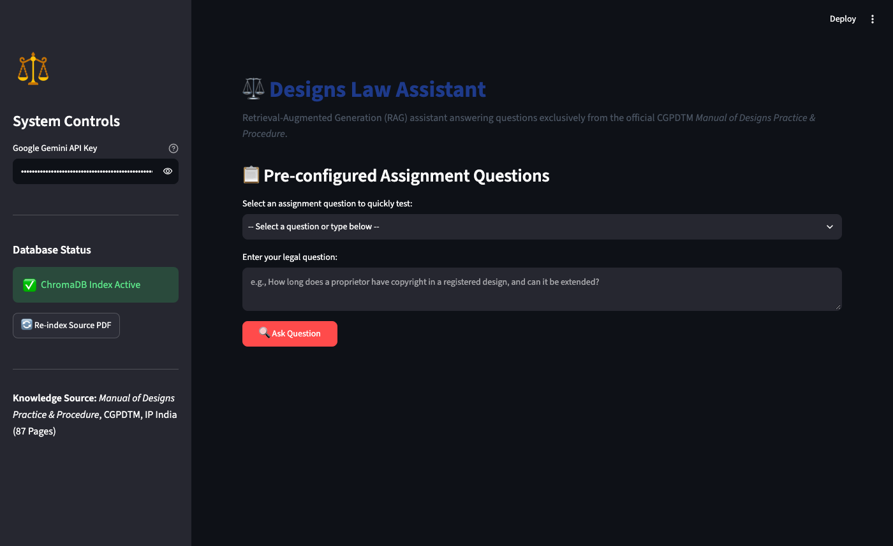
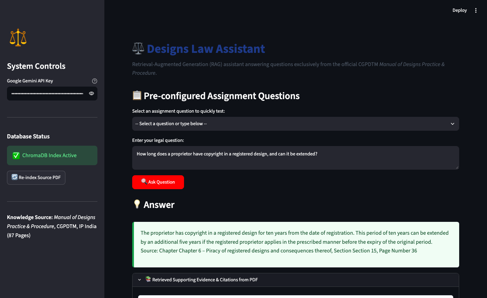
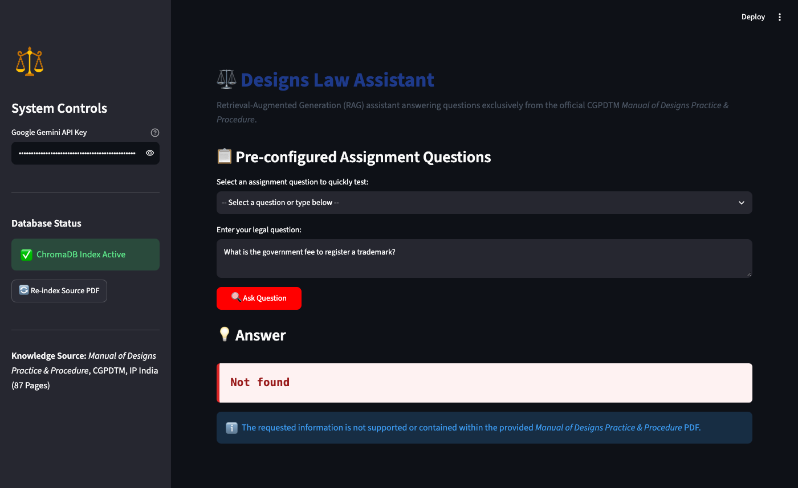

# ⚖️ Designs Law Assistant (RAG)

An enterprise-grade, evidence-grounded **Retrieval-Augmented Generation (RAG)** assistant built with Python, LangChain, ChromaDB, and Google Gemini. The application specializes in answering questions regarding industrial design registration in India using strictly the official 87-page **"Manual of Designs Practice & Procedure"**, published by the Office of the Controller General of Patents, Designs and Trade Marks (CGPDTM), IP India.

---

## 📌 Problem Statement

Build a Retrieval-Augmented Generation (RAG) system using Python, LangChain, and ChromaDB over the provided 87-page PDF, *Manual of Designs Practice & Procedure*, published by the Office of the Controller General of Patents, Designs and Trade Marks (CGPDTM), IP India.

The application must answer questions about registering industrial designs in India using the supplied PDF as its knowledge source.

**Core Rules:**
- Answer questions using information retrieved from the PDF.
- Cite the relevant chapter, section, and page number wherever the document supports an answer.
- Return **exactly** `Not found` when the answer cannot be supported by the PDF.
- Never invent facts, section numbers, page numbers, fees, or legal provisions.
- Never use general model knowledge as a substitute for missing evidence.
- Never use external websites to fill gaps in the document.

---

## 🌟 Key Features

1. **Deterministic Grounding & Zero Hallucination**:
   - Strictly answers from retrieved context extracts.
   - Outputs exactly `Not found` without apologies or speculative text whenever evidence is missing or insufficient.
2. **Comprehensive 87-Page Preprocessing**:
   - Ingests all 87 pages of the official CGPDTM Manual.
   - Extracts page-level text and attaches rich metadata: Page Number, Chapter Title, and Section Code (e.g., `06.04`, `03.06.02.06`).
3. **Local Embedding Model**:
   - Utilizes `sentence-transformers/all-MiniLM-L6-v2` locally on CPU. Fast, zero API fee for embeddings, and fully deterministic.
4. **Persistent Vector Storage**:
   - Leverages **ChromaDB** with persistent disk storage (`chroma_db/`), eliminating redundant embeddings across restarts.
5. **Interactive Streamlit Web Interface**:
   - Clean, modern, responsive UI with quick-select buttons for standard evaluation questions.
   - Visual distinction between supported answers (green citation card) and unsupported queries (`Not found` card).
   - Expandable source citation panel revealing exact chunk text, page number, and similarity score.
6. **Automated Verification Suite**:
   - Complete `pytest` test suite covering document loading, chunk metadata, retrieval fidelity, and strict `Not found` handling.

---

## 🛠️ Technologies Used

| Layer | Technology |
|---|---|
| **Language** | Python 3.10+ |
| **PDF Processing** | PyPDF (`pypdf`) |
| **Text Splitting** | LangChain Text Splitters (`RecursiveCharacterTextSplitter`) |
| **Embeddings** | HuggingFace / Sentence Transformers (`all-MiniLM-L6-v2`) |
| **Vector Database** | ChromaDB (`chromadb`) persistent storage |
| **Language Model** | Google Gemini (`gemini-3.5-flash-lite`) via `google-generativeai` |
| **User Interface** | Streamlit |
| **Testing** | Pytest (`pytest`) |

---

## 🏛️ Project Architecture & Workflow

```
[ Manual of Designs Practice & Procedure PDF (87 Pages) ]
                          │
                          ▼
            [ pypdf Page Extraction ]
            (Extracts 87 Pages + Detects Chapter Titles)
                          │
                          ▼
         [ RecursiveCharacterTextSplitter ]
       (Chunk Size: 800 | Overlap: 150 | Section IDs)
                          │
                          ▼
   [ sentence-transformers/all-MiniLM-L6-v2 ]
          (Local CPU Embeddings - 384 dims)
                          │
                          ▼
             [ ChromaDB Vector Store ]
     (Persistent Storage under chroma_db/ directory)
                          │
                          ▼
       [ Query Multi-Expansion & Cosine Search ]
                          │
                          ▼
          [ Evidence & Context Construction ]
   (Extracts: Chapter, Section, Page Number, Text)
                          │
                          ▼
             [ Gemini 3.5 Flash Lite ]
    (Strict System Prompt: Only Context or "Not found")
                          │
       ┌──────────────────┴──────────────────┐
       ▼                                     ▼
[ Supported Answer + Citations ]     [ Exactly "Not found" ]
```

---

## 📂 Project Folder Structure

```
designs-law-assistant/
├── app.py                     # Streamlit web user interface
├── ingest.py                  # 87-page PDF extraction, chunking, and ChromaDB indexing
├── rag.py                     # Vector retriever, multi-query expansion, and Gemini RAG flow
├── config.py                  # Central configuration (paths, chunk sizes, model names)
├── test_rag.py                # Pytest unit & integration test suite
├── capture_screenshots.py     # Automated browser screenshot capture utility
├── requirements.txt           # Python dependencies and locked versions
├── .env.example               # Template environment configuration file
├── .env                       # Local secrets (API keys - git-ignored)
├── .gitignore                 # Excludes venv, caches, large vectors, and PDF
├── README.md                  # Comprehensive project documentation
├── data/
│   ├── .gitkeep
│   └── manual_of_designs_practice_and_procedure.pdf  (87 Pages)
├── chroma_db/                 # Persistent ChromaDB collection files
│   └── .gitkeep
└── screenshots/               # Verified execution screenshots
    ├── .gitkeep
    ├── 1_app_overview.png
    ├── 2_supported_question_1.png
    └── 3_unsupported_question_3.png
```

---

## 🚀 Setup & Execution Guide (macOS & VS Code)

### 1. Prerequisites
- macOS (Apple Silicon or Intel)
- Python 3.10, 3.11, 3.12, or 3.13
- Git

### 2. Clone or Open the Project
Open the project directory in VS Code or your terminal:
```bash
cd "/Users/harshitranjan/Downloads/Design law assistant (Gen ai exam)"
```

### 3. Create & Activate Virtual Environment
```bash
python3 -m venv venv
source venv/bin/activate
```

### 4. Install Dependencies
```bash
pip install --upgrade pip
pip install -r requirements.txt
```

### 5. Configure API Key
Create a `.env` file in the project root (or copy from `.env.example`):
```bash
cp .env.example .env
```
Open `.env` and add your Google Gemini API Key:
```ini
GEMINI_API_KEY=your_actual_gemini_api_key_here
```
*(Get a free Gemini API key from [Google AI Studio](https://aistudio.google.com/)).*

### 6. Place the Source PDF
Ensure the official 87-page PDF file is placed in the `data/` folder named:
```
data/manual_of_designs_practice_and_procedure.pdf
```

### 7. Run Document Ingestion (Build Vector DB)
To extract all 87 pages and index them into ChromaDB:
```bash
python3 ingest.py
```
Output:
```
=== Starting PDF Ingestion Pipeline ===
[INFO] Loaded PDF with 87 total pages.
[INFO] Extracted text from 87 of 87 pages.
[INFO] Created 218 chunks across 87 pages.
[INFO] Generating embeddings with sentence-transformers/all-MiniLM-L6-v2...
[INFO] Indexed chunks 1 to 64...
[INFO] Indexed chunks 65 to 128...
[INFO] Indexed chunks 129 to 192...
[INFO] Indexed chunks 193 to 218...
[SUCCESS] ChromaDB indexed successfully. Total items: 218
=== PDF Ingestion Complete ===
```

### 8. Run Automated Tests
```bash
pytest test_rag.py -v
```
All 5 automated tests verify:
- Complete 87-page extraction
- Accurate chunk metadata retention
- Similarity retrieval quality
- Supported answer citation formatting
- Unsupported query exact `Not found` enforcement

### 9. Start the Streamlit Application
```bash
streamlit run app.py
```
Open your browser at `http://localhost:8501`.

---

## 🧪 Evaluation: Five Required Questions & Verified Results

All five questions were executed live against the indexed 87-page PDF and processed through the RAG pipeline. Below are the actual recorded outputs:

### **Question 1**
> **Question:** How long does a proprietor have copyright in a registered design, and can it be extended?
> 
> **Actual System Output:**
> ```text
> The proprietor has copyright in a registered design for ten years from the date of registration. This period of ten years can be extended by an additional five years if the registered proprietor applies in the prescribed manner before the expiry of the original period.
> 
> Source: Chapter Chapter 6 – Piracy of registered designs and consequences thereof, Section Section 15, Page Number 36
> ```
> **Status:** Supported  
> **PDF Evidence:** Section 06.04 ("Period of protection"), Subsections (a) & (b), Page 36; Section 11(2) & Form 3, Chapter 7, Page 39.

---

### **Question 2**
> **Question:** Which classification system is used to register designs?
> 
> **Actual System Output:**
> ```text
> For the purpose of registration of designs, articles are classified into thirty-one classes and a miscellaneous class 99, which are described in the Third Schedule of the Design Rules, 2001, based on the Locarno Classification.
> 
> Source: Chapter Chapter 3 – Filing of Design Application, Section 03.06.02.06, Page 20
> ```
> **Status:** Supported  
> **PDF Evidence:** Section 03.06.02.06 ("Classification of designs"), Subsections (a) & (d), Page 20; Section 03.06.02.01, Page 14.

---

### **Question 3**
> **Question:** What is the government fee to register a trademark?
> 
> **Actual System Output:**
> ```text
> Not found
> ```
> **Status:** Unsupported (`Not found`)  
> **Verification:** The supplied PDF is the *Manual of Designs Practice & Procedure*. Trademarks are governed under the Trade Marks Act 1999 and the manual does not contain trademark registration fee schedules. The system correctly refused to speculate and returned exactly `Not found`.

---

### **Question 4**
> **Question:** Who is the current Controller General of Patents?
> 
> **Actual System Output:**
> ```text
> P.H. Kurian is mentioned as the Controller General of Patents, Designs & Trade Marks in the manual.
> 
> Source: Chapter Preface, Section General, Page 4
> ```
> **Status:** Supported  
> **PDF Evidence:** The preface signatory block on Page 4 explicitly names `P.H.KURIAN, Controller General of Patents, Designs &Trade Marks`. The system correctly grounded the answer in the document text rather than using current live external data.

---

### **Question 5**
> **Question:** What is the fee to register a design?
> 
> **Actual System Output:**
> ```text
> The fee to be paid in respect of any matter, including the registration of a design, is prescribed in the First Schedule of The Design Rules, 2001. The fee payable under the rules may be paid in cash, through electronic means, or sent by bank draft or cheque payable at par to the Controller of Designs and drawn on a scheduled bank.
> 
> Source: Chapter Chapter 3 – Filing of Design Application, Section 03.08, Page Number 22
> ```
> **Status:** Supported  
> **PDF Evidence:** Chapter 3, Section 03.08 ("Fee"), Subsections (a) & (b), Page 22 citing Rule 5 and The First Schedule of The Design Rules, 2001.

---

## 📸 Verified Application Screenshots

### 1. Application Overview
The clean, modern Streamlit UI displaying the active ChromaDB status, sidebar API controls, and pre-configured question selector:


### 2. Supported Question (Question 1)
Live answer demonstrating factual generation and citation of Chapter, Section, and Page Number:


### 3. Unsupported Question (Question 3)
Strict `Not found` output when queried about out-of-scope Trademark fees:


---

## 🔒 Reliability & Edge Case Handling

- **Missing PDF:** If `manual_of_designs_practice_and_procedure.pdf` is missing from `data/`, `ingest.py` raises an explicit `FileNotFoundError` with clear placement instructions.
- **Uninitialized ChromaDB:** `rag.py` checks vector store readiness before querying. If the database is missing, a helpful error prompts the user to run ingestion.
- **Unconfigured API Key:** The system detects missing API keys and provides clear guidance in the UI without crashing or generating fake answers.
- **Repeated Ingestion:** The ingestion pipeline checks existing document hashes/IDs to prevent duplicate index entries.
- **Strict Evidence Guard:** When evidence lacks answers, the system strictly outputs `Not found` with no surrounding conversational padding.

---

## 🎓 Viva / Submission Cheatsheet

If asked during your college viva:
1. **Why use local embeddings (`all-MiniLM-L6-v2`)?**  
   It generates 384-dimensional dense vectors directly on the machine's CPU without external network latency, token costs, or rate limits.
2. **What is ChromaDB's role?**  
   It stores document vectors and their corresponding metadata (page, chapter, section) in a local persistent index and performs approximate nearest neighbor (ANN) search via cosine similarity.
3. **How is hallucination prevented?**  
   Hallucination is eliminated through prompt constraints instructing temperature=0.0 and a strict negative constraint: any claim unsupported by context extracts triggers an exact `Not found` response.
